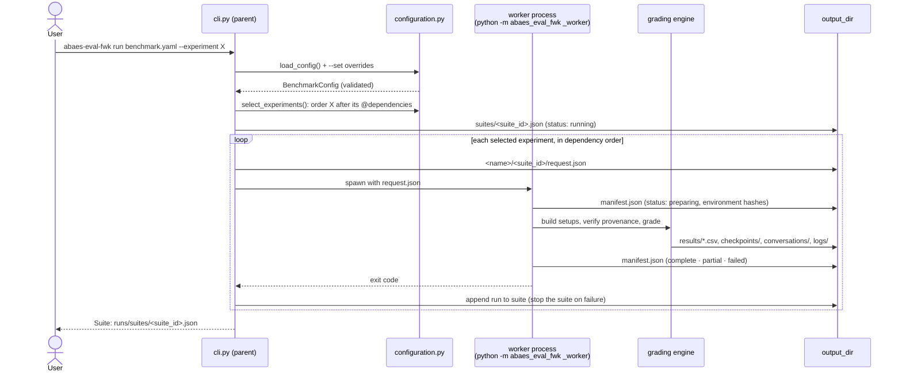
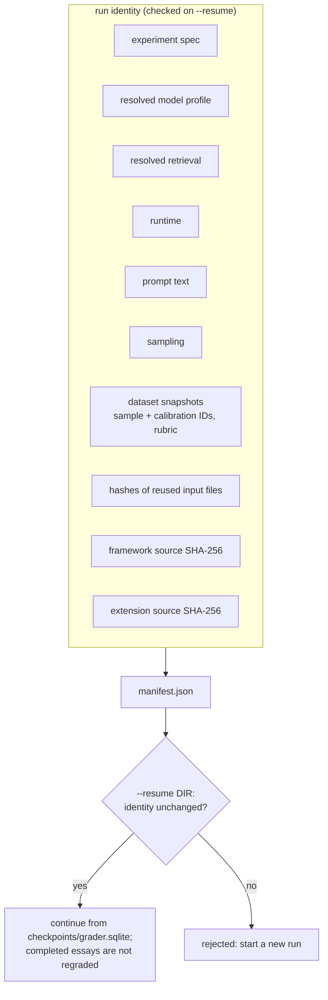

# Run lifecycle

What happens between `abaes-eval-fwk run` and a finished suite, and how every run records its inputs.

`run` keeps the parent process thin. Each experiment executes in its own Python process, so a
crash, a leaked thread, or global state in one experiment can't contaminate the next.

A dependency's manifest feeds the next experiment: `@name` references in `reuse` resolve to the
results file the dependency's manifest recorded, and a dependency that didn't reach `complete`
stops the suite.

## Provenance and resume

Every run records what it was given, so a result can be traced and a resume can't silently mix
inputs.

The manifest also records the Python version, platform, installed package versions, artifact
paths, timestamps, and earlier attempts. Checkpoints are keyed by (rubric, essay, criterion), and
the checkpoint file is specific to the variant, model, and source experiments, so two runs can't
read each other's records.

---

[← Overview](README.md) · [Overview](README.md) · [Configuration resolution →](02-configuration-resolution.md)
