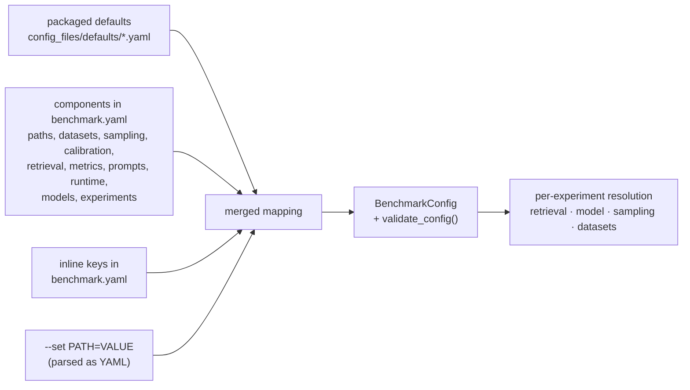

# Configuration resolution

How `benchmark.yaml`, its components, defaults, and `--set` combine into one validated configuration.

`benchmark.yaml` is only a map of component files. All relative paths resolve against
`benchmark.yaml`'s directory, so a project folder can be moved anywhere.

Later sources win; mappings merge recursively. Several `experiments` files are concatenated
rather than merged. Each experiment then resolves its own effective settings: its `retrieval`
merges over the project's, its `model` profile merges over `model_defaults`, and its `sampling`
and `datasets` narrow the project's. Validation runs before any model is contacted. It rejects
unknown keys, invalid values, unknown model profiles, dependency cycles, and controlled
comparisons that differ on more than they declare. Details: [configuration](../configuration.md).

---

[← Run lifecycle](01-run-lifecycle.md) · [Overview](README.md) · [Samples, calibration, and retrieval →](03-setup-and-retrieval.md)
