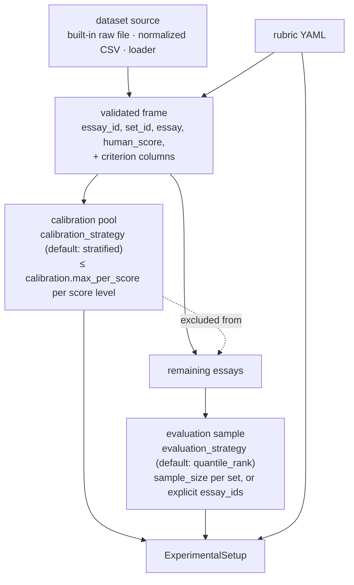
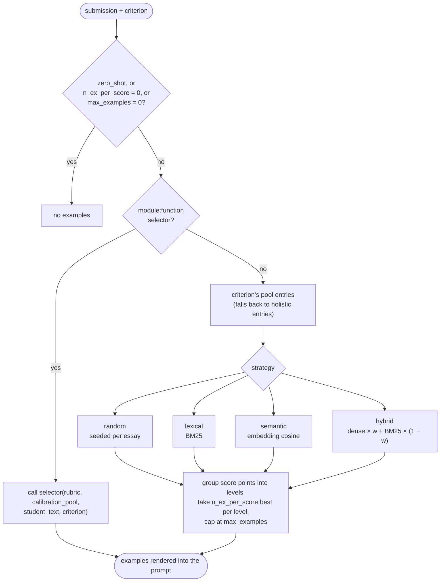

# Samples, calibration, and retrieval

Which essays are graded, which become few-shot examples, and how examples are picked for each essay.

## Samples and calibration pools

Every dataset an experiment uses becomes one *setup*: a rubric, an evaluation sample, and a
calibration pool to draw few-shot examples from.

Calibration essays are never graded. Pools are cached under `<output_dir>/calibration/`, keyed
by a fingerprint of the data and strategy. A cached pool that no longer matches what the strategy
would produce raises an error (delete it to rebuild) instead of being reused. `prepare` runs this
stage alone and writes the IDs to `<output_dir>/splits/<hash>.json`, with no model or embedding
calls.

A final-agent or review experiment doesn't sample. Its essays are the ones in the prior results
it reuses.

## Example retrieval

Few-shot examples come from the calibration pool, stratified by human score so the model sees
the scale's range rather than near-duplicates of one level.

Randomness is seeded from the rubric, the essay text, and `seed`, so a rerun picks the same
examples. Embeddings and BM25 indexes are cached under `<output_dir>/cache/retrieval/`, keyed by
a hash of the pool's IDs, scores, criteria, and text, so a changed pool can't reuse stale
vectors. `semantic` and `hybrid` need the `dense` extra.

---

[← Configuration resolution](02-configuration-resolution.md) · [Overview](README.md) · [Grading architectures →](04-grading-architectures.md)
