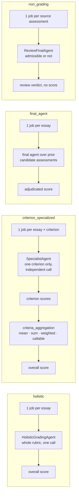

# Grading architectures

What `architecture` changes: how many jobs and model calls an essay becomes, and how agents call the model.

`architecture` selects which node the per-essay LangGraph workflow runs. Each graph is a single
node; what differs is what that node does and how many jobs a submission fans out into.

| Architecture | Procedure | Model calls per essay | Needs prior results |
|---|---|---|---|
| `holistic` | `none` | 1 (+ retries) | no |
| `criterion_specialized` | `none` | one per criterion, each in its own conversation | no |
| `final_agent` | `pool_average` | 0 | ≥ 2 candidate files |
| `final_agent` | `disagreement` | 0 or 1 (justification only, on agreement) | ≥ 2 candidates + the final model's independent run |
| `final_agent` | `review_based` | one review per candidate (cacheable) + 0 or 1 | ≥ 2 candidates + independent run |
| `non_grading` | `review` | one per source assessment | exactly 1 source file |

Specialists never see the other criteria, so one criterion's judgment can't anchor another's.
Every architecture is evaluated against the dataset's overall human score. Criterion scores are
kept per row and combined with the rubric's `criteria_aggregation`.

All agents share `BaseAgent`. It renders the template from `prompts`, binds the structured-output
schema, retries up to `runtime.max_attempts`, records tokens and timing, and optionally logs the
conversation. A response cut off at the token limit counts as a retryable failure, not a parse.
If the context window overflows, the call fails, unless `runtime.context_overflow:
truncate_examples` allows retrying with each example cut to 80%, 60%, 40%, then 20% of its
length.

---

[← Samples, calibration, and retrieval](03-setup-and-retrieval.md) · [Overview](README.md) · [Final-agent procedures →](05-final-agent-procedures.md)
