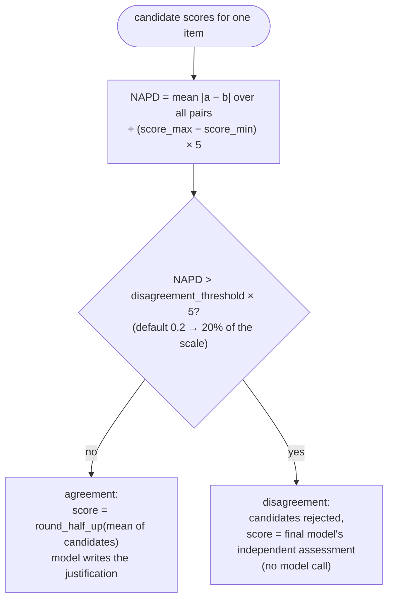
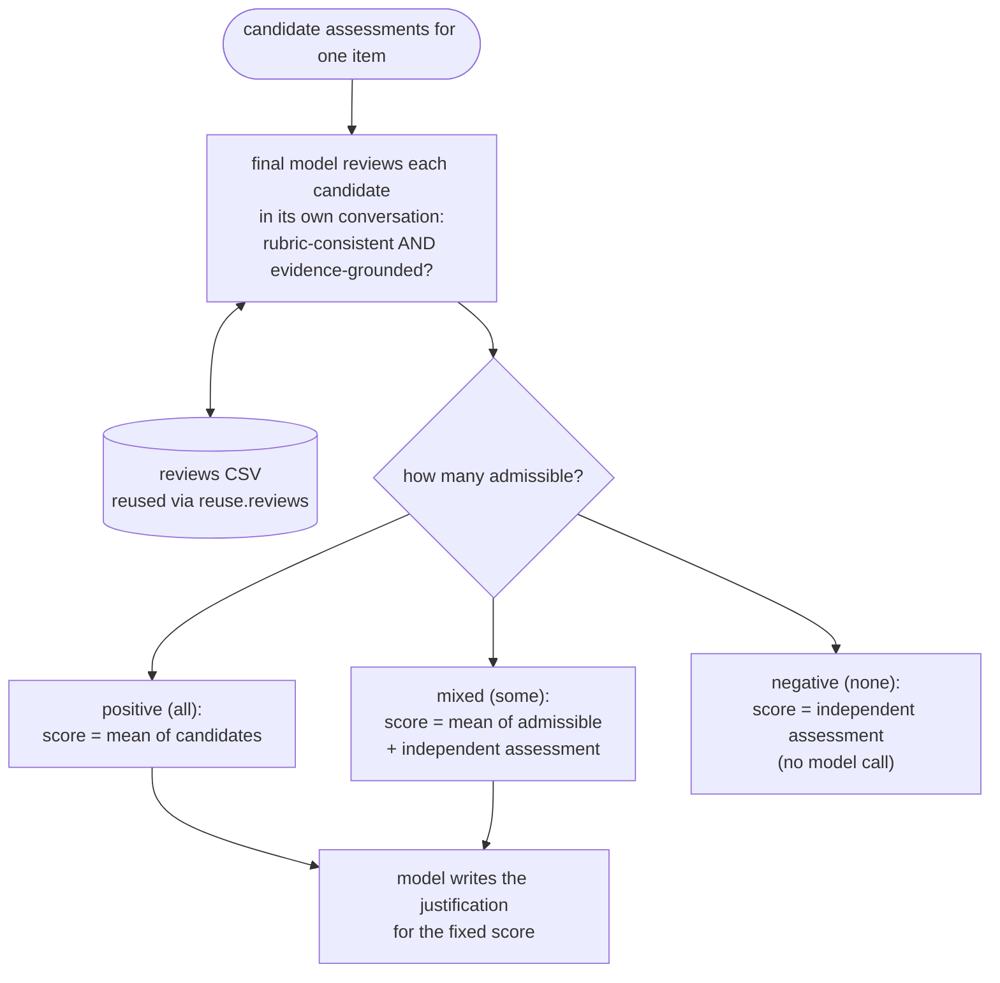
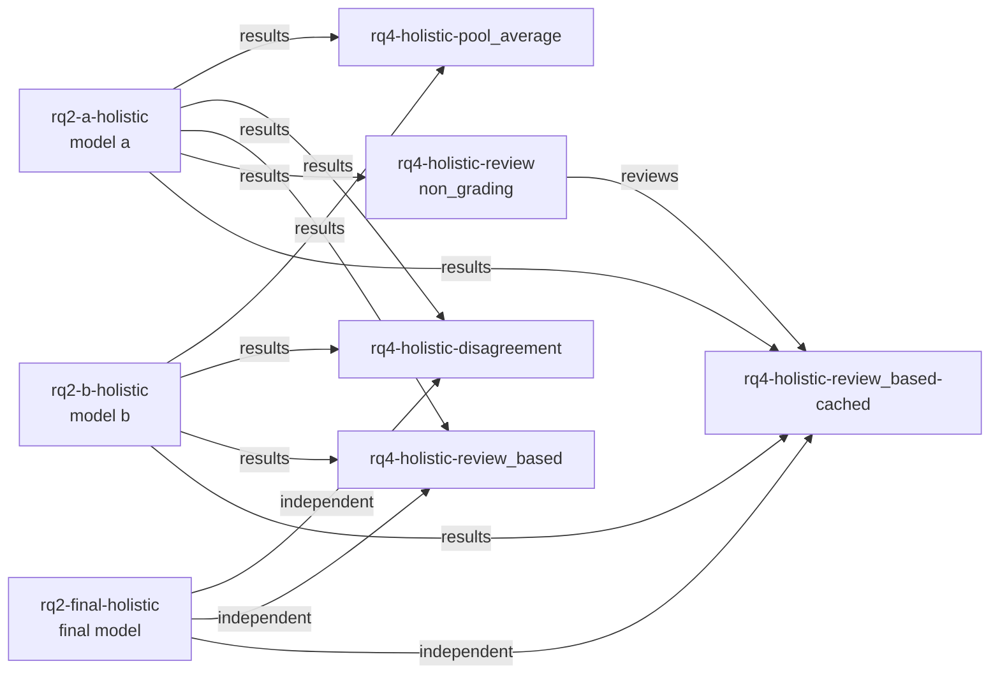

# Final-agent procedures

How RQ4 experiments combine earlier assessments, and how they depend on the experiments that produced them.

A final agent works from the assessments that earlier experiments produced (the *candidates*).
Adjudicating procedures also need the final model's own *independent* assessment of each essay,
made earlier and without seeing the candidates. Every branch's score is decided
deterministically from those inputs. When the model is called, it's only to justify a score
already fixed, so it can't be talked into a candidate's number.

For `criterion_specialized` candidates, each criterion is adjudicated as its own item in one
shared conversation, followed by a synthesis turn. Holistic candidates are a single item.

## pool_average

The candidates' scores are averaged and rounded half-up to a score level. No model call. This
is the baseline the adjudicating procedures are compared against.

For `criterion_specialized` candidates, each candidate's criterion scores are first combined
into that candidate's overall score with the rubric's `criteria_aggregation`. The baseline is
then the half-up rounded mean of those overall scores. Criteria are never averaged across
candidates before aggregation, so a `sum` rubric with candidates totalling 0 and 2 scores 1.

## disagreement

NAPD (normalized average pairwise disagreement) puts every rubric on a common 0–5 reference
width, so one threshold works across scales of different sizes and any number of candidates.

## review_based

A review judges two things: whether the score is consistent with the rubric's level
guidelines, and whether the justification is grounded in evidence from the essay. A candidate is
admissible only if it passes both. Each review runs in a separate conversation so no verdict
anchors another. Reviews are written
to the run's reviews CSV. A `review` (`non_grading`) experiment produces them on their own, and a
later `review_based` experiment can replay them through `reuse.reviews` instead of asking again.

## Experiment dependencies

`reuse` entries can name earlier experiments as `@name`. Selecting an experiment schedules its
dependencies first, depth-first, and rejects cycles and unknown names. The playground's RQ4
experiments form this graph:

`abaes-eval-fwk run benchmark.yaml --experiment rq4-holistic-disagreement --dry-run` prints this
order before anything runs.

---

[← Grading architectures](04-grading-architectures.md) · [Overview](README.md) · [Evaluation →](06-evaluation.md)
