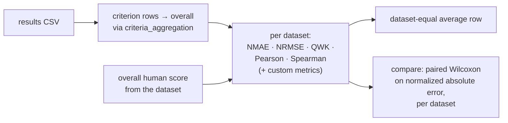

# Evaluation

How results become metrics and paired comparisons.

`run` computes metrics automatically when `runtime.compute_metrics` is true. `metrics`,
`compare`, and `baseline` rerun the same code on CSVs already on disk. NMAE, the primary metric,
rescales each absolute error to a 0–10 scale (`× 10 / (score_max − score_min)`) and averages
them, so datasets with different scales share one reference.

`adjudication` reports how the final-agent procedures resolve a pool. It recomputes every DA
outcome from the pool's source results with the disagreement rule the procedure applies, counts
RA outcomes from the pool's reviews CSVs, and averages the reviews' completion tokens per essay
for each reviewed source. Boolean review columns (`rubric_consistency`, `evidence_grounding`,
`is_admissible`) are `1` or `0` in every CSV the framework writes or reads.

---

[← Final-agent procedures](05-final-agent-procedures.md) · [Overview](README.md)
