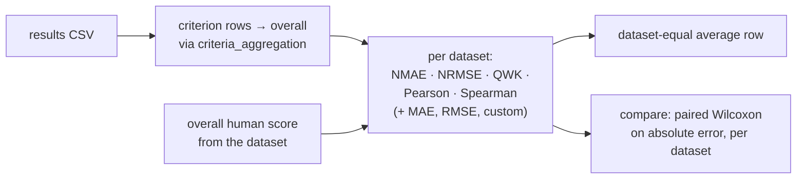

# Evaluation

How results become metrics and paired comparisons.

`run` computes metrics automatically when `runtime.compute_metrics` is true. `metrics`,
`compare`, and `baseline` rerun the same code on CSVs already on disk. NMAE, the primary metric,
is `10 × MAE / (score_max − score_min)`, which puts datasets with different scales on one 0–10
reference.

---

[← Final-agent procedures](05-final-agent-procedures.md) · [Overview](README.md) · [Overview](README.md)
