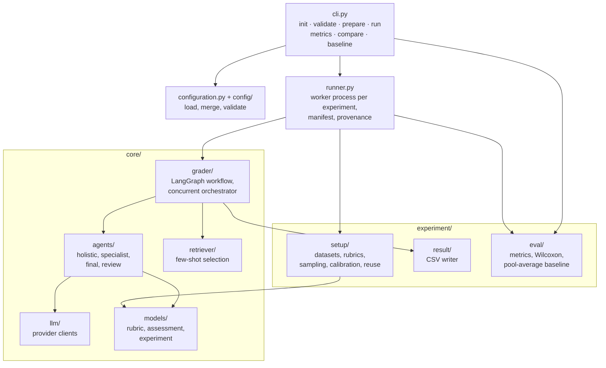

# Architecture

How a `benchmark.yaml` becomes graded essays and metrics. Read this to understand what each
setting changes, where a run can fail, and which code to open when extending the framework.

## Chapters

1. [Run lifecycle](01-run-lifecycle.md) — What happens between `abaes-eval-fwk run` and a finished suite, and how every run records its inputs.
2. [Configuration resolution](02-configuration-resolution.md) — How `benchmark.yaml`, its components, defaults, and `--set` combine into one validated configuration.
3. [Samples, calibration, and retrieval](03-setup-and-retrieval.md) — Which essays are graded, which become few-shot examples, and how examples are picked for each essay.
4. [Grading architectures](04-grading-architectures.md) — What `architecture` changes: how many jobs and model calls an essay becomes, and how agents call the model.
5. [Final-agent procedures](05-final-agent-procedures.md) — How RQ4 experiments combine earlier assessments, and how they depend on the experiments that produced them.
6. [Evaluation](06-evaluation.md) — How results become metrics and paired comparisons.

## Package layout

| Package | Responsibility |
|---|---|
| `config/` | Frozen dataclasses for every setting (`SamplingConfig`, `RetrievalConfig`, `LLMConfig`, …), each validating itself on construction; `config_files/` holds the packaged defaults and the `playground`/`study` templates |
| `configuration.py` | Reads `benchmark.yaml`, merges defaults → components → overrides, resolves per-experiment settings, checks controlled comparisons |
| `runner.py` | Executes one experiment in a worker process; writes `manifest.json`; verifies resume provenance |
| `experiment/setup/` | Loads and validates datasets and rubrics, draws evaluation samples and calibration pools, loads prior results for final agents |
| `core/grader/` | Compiles a LangGraph workflow per experiment type and grades submissions concurrently, with SQLite checkpoints |
| `core/agents/` | Prompt rendering, structured-output parsing, retries, and token accounting for each agent type |
| `core/retriever/` | Picks score-stratified few-shot examples from the calibration pool |
| `core/llm/` | Builds the chat client for a model profile (built-in providers or an `adapter_factory`) |
| `experiment/eval/` | Metrics, paired Wilcoxon comparisons, pool-average baselines |
